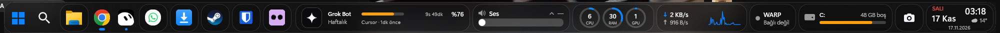
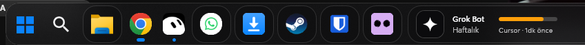
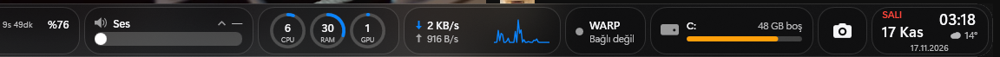
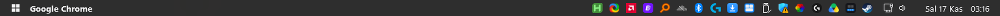

# Kuti Dock

Windows 11 için macOS tarzı bir dock. Uygulama simgeleri, üzerine gelince büyür, tıklanınca pencere Genie efektiyle
simgesine küçülür; yanında sistem, ses, disk, ağ ve kullanım bilgisi gösteren küçük paneller bulunur. Ekranın üstünde
etkin uygulamanın adını, tepsi simgelerini ve saati gösteren bir menü çubuğu vardır. İsteğe bağlı olarak Windows görev
çubuğunu tamamen kaldırır.

C#, .NET 8 ve WPF ile yazıldı. Son sürüm: **1.6.17**. Eski adı Kutay Dock.



## Özellikler

**Dock**
- Klasik Kuti Dock düzeni: solda Başlat ve arama, ortada uygulamalar, sağda widget'lar.
- Mac dock'taki gibi dalga büyütme: imlecin altındaki simge en çok, komşuları daha az büyür. Şerit kaymaz, simgeler
  kesilmez (büyütülmüş simgeler ayrı, tıklamayı geçiren bir katmanda çizilir).
- Genie efekti: dock'tan tıklayınca ya da pencerenin kendi küçültme düğmesiyle (Win+Aşağı dahil) pencere simgesine
  akarak küçülür, geri açılırken aynı yoldan büyür. Direct3D 11 ve DirectComposition ile ekran kartında çizilir;
  kullanılamazsa normal küçültmeye döner.
- Apple tarzı yay (spring) hareketi: büyütme, paneller, menüler ve gizlenip belirme yarıda kesilebilir, 60 fps'te
  akar; panel dock'tan bulanık ve küçük başlayıp netleşerek açılır. Ayrıntı: [docs/APPLE-HAREKET.md](docs/APPLE-HAREKET.md).
- Açılış ve dikkat sıçraması, çalışan uygulama noktaları, Windows 11 tarzı canlı pencere önizlemesi.
- Otomatik gizleme: dock ekranın altında saklanır, imleç kenara gelince kayarak çıkar, imleç uzaklaşınca geri iner.
- Tam ekran video ve oyunlarda dock gizlenir.
- Alt, sol ya da sağ kenar; çoklu monitör ve farklı DPI ölçekleri. Saklı dock fareyi takip eder: hangi ekranın kenarına
  gidersen orada belirir (Ayarlar > Davranış'tan kapatılabilir ya da yalnızca ana ekrana sabitlenebilir).

**Üst menü çubuğu**
- Etkin uygulamanın adı, logoya tıklayınca Başlat menüsü.
- Finder gibi işlevli menüler: uygulamanın kendi Win32 ya da UI Automation menüsü, yoksa Dosya/Düzen/Görüntü/Pencere/Yardım;
  uygulama adı menüsünde gizle, diğerlerini gizle, çık. Masaüstü öndeyken Gezgin menüleri (Git, Geri Dönüşüm Kutusu).
- Tepsi simgeleri (tıklama, çift tıklama ve sağ tık menüleri uygulamaya iletilir), sinyal gücüyle Wi-Fi, ses, pil,
  tarih ve saat. Her monitörde bir çubuk.

**Görev çubuğunu kaldırma**
- Windows görev çubuğu tamamen gizlenir; Explorer yeniden başlasa, ekran değişse ya da tam ekrandan çıkılsa da geri
  gelmez. Win tuşu Başlat menüsünü açmaya devam eder.
- Dock kapanır ya da çökerse ayrı bir bekçi süreci görev çubuğunu geri getirir. Acil durum için
  `KutiDock.exe --restore-taskbar`, geçici gösterim için Ctrl+Alt+Shift+B.

**Widget panelleri**
- Grok Bot ve Cursor kullanım limitleri (isteğe bağlı Cursor girişi, oturum DPAPI ile şifreli saklanır).
- Ses: seviye ve çıkış aygıtı seçimi.
- Diskler: doluluk ve klasör boyutları (Everything kuruluysa).
- Sistem: RAM temizliği, geçici dosyalar (silmeden önce MB önizlemesi ve onay), DNS önbelleği. Oyun açıkken devre dışı.
- Ağ, Cloudflare WARP bağlan/kes, pil, saat ve tarih, ShareX ile ekran görüntüsü.
- Arama: Windows araması gibi uygulamalar, ayarlar ve dosyalar; isteğe bağlı Everything.
- Paneller dışarı tıklayınca, başka pencereye geçince ya da Esc ile kapanır.

## Ekran görüntüleri

Görüntüler 2560×1440 ekranda, 1.6.4 ile alındı (1.6.5'te görünüm aynı, yalnızca hareket değişti).

Dock, solda Başlat, arama ve uygulamalar:



Sağdaki widget'lar: Grok Bot ve Cursor kullanımı, ses, sistem, ağ, WARP, disk, ekran görüntüsü, tarih ve saat:



Üst menü çubuğunun iki ucu: etkin uygulama ve tepsi simgeleri, ses, tarih ve saat:



## Gereksinimler

- Windows 11, x64. Windows 10'da denenmedi.
- Yayınlanan exe kendi .NET çalışma zamanını içerir; ayrıca kurulum gerekmez.
- Genie efekti için Direct3D 11 destekleyen bir ekran kartı.
- İsteğe bağlı: [Everything](https://www.voidtools.com/) (klasör boyutları ve hızlı arama),
  [ShareX](https://getsharex.com/), Cloudflare WARP.

## Kurulum

1. [Releases](https://github.com/kutaykilicai/kuti-dock/releases) sayfasından `KutiDock.exe` dosyasını indirin.
2. İstediğiniz bir klasöre koyup çalıştırın. Yönetici izni gerekmez.
3. Ayarlar tepsi simgesinden ya da dock'a sağ tıklayarak açılır. Windows ile başlatma, kenar, otomatik gizleme,
   görev çubuğunu kaldırma, büyütme ve animasyonlar buradan açılıp kapatılır.

Ayarlar `%APPDATA%\KutiDock` altında tutulur. Kutay Dock'tan geçenlerin ayarları ilk açılışta oradan kopyalanır.
Ayrıntılı kullanım notları: [OKUBENI.txt](OKUBENI.txt).

## Derleme

.NET 8 SDK gerekir.

```
dotnet test tests/KutiDock.Tests
dotnet publish src/KutiDock -c Release -o publish
```

Çıktı tek dosyalık, win-x64, kendi çalışma zamanını içeren `publish/KutiDock.exe`'dir. `EnableWindowsTargeting` açık
olduğundan Linux ve macOS'ta da derlenir; uygulama yalnızca Windows'ta çalışır.

## Proje yapısı

```
src/KutiDock          WPF uygulaması: dock penceresi, widget'lar, menü çubuğu bağlantısı, ayarlar
src/KutiDock.Mac      Mac dock motoru: büyütme, sıçrama, Genie, menü çubuğu, görev çubuğu (Gravitone tabanlı)
src/KutiDock.Core     platformdan bağımsız mantık: ayarlar ve taşıma, otomatik gizleme, limitler, yerleşim
tests/KutiDock.Tests  xUnit testleri
```

## Sürüm notları

Ayrıntılar [CHANGELOG.md](CHANGELOG.md) dosyasında.

- **1.6.17** Lively duvar kağıdı bekçisi: duvar kağıtları kaybolursa (dock yeniden başlaması, ekran değişikliği) pencere açmadan geri yükler; tam ekran oyunda çalışmaz.
- **1.6.16** Limit panelinde Gemini Güncel ve Haftalık kullanım kartları (Chrome eklentisi `extensions/gemini-usage` ile, yalnızca 127.0.0.1).
- **1.6.15** Limit panelinde AllModels, OpenRouter, Kimi (Moonshot) bakiyeleri (resmi API, DPAPI ile şifreli anahtarlar) ve Gemini sayfa bağlantısı.
- **1.6.14** "Aramada Everything kullan" açıkken Everything arka planda kendiliğinden başlar, aramalar onu kullanır; kapatınca dock'un açtığı Everything kapanır.
- **1.6.13** Simgeye sağ tıklayınca "Görevi sonlandır": donmuş uygulamayı onaysız, alt süreçleriyle kapatır (PWA'da yalnızca pencere).
- **1.6.12** TV Aç-Kapat simgesi TV'nin açık mı kapalı mı olduğunu gösterir (yeşil nokta / gri simge ve "kapalı" rozeti).
- **1.6.11** Arama panelinde Everything anahtarı (gerekirse Everything'i arka planda başlatır). WARP'a dock'tan bağlanınca uygulaması da başlar.
- **1.6.10** Sıfırdan açılan uygulamalar dock saklıyken de simgeden Genie ile açılır; dock kısa süre belirir. Arama önce uygulamaları gösterir.
- **1.6.9** Dock her ekrana kenar boşluklarıyla sığar (küçültme, kompakt grup, taşma menüsü).
- **1.6.8** Dock fareyi takip eder: saklıyken hangi ekranın kenarına gidersen orada belirir.
- **1.6.7** WhatsApp Web gibi Chrome uygulamaları dock'tan küçülür; ilk açılış Genie'si sistem genelinde.
- **1.6.6** Ses bölümü onarıldı, Finder tarzı işlevli menü çubuğu, Chrome PWA'ları ayrı simgede, ilk açılışta Genie.
- **1.6.5** Apple tarzı yay animasyonları (büyütme, paneller, menüler, otomatik gizleme, Genie zamanlaması).
- **1.6.4** Pencerenin kendi küçültme düğmesinde de Genie; paneller ve sağ tık menüleri dışarı tıklayınca ve Esc ile kapanır.
- **1.6.3** Görev çubuğu tamamen kaldırılır, dock otomatik gizlenir, Genie daha güvenilir.
- **1.6.2** Klasik dock yeniden varsayılan; simgelerde Mac büyütmesi, sıçrama ve Genie.
- **1.6** Kutay Dock'un adı Kuti Dock oldu; Gravitone tabanlı Mac dock motoru ve üst menü çubuğu.

## Lisans ve kaynaklar

MIT © 2026 Kutay Kılıç. Bkz. [LICENSE](LICENSE).

Mac dock motoru [Gravitone](https://github.com/lupanostefano/Gravitone) (MIT, Copyright (c) 2026 Stefano Lupano)
kaynak kodu üzerine kuruludur. Lisans metni ve hangi parçaların alındığı
[THIRD-PARTY-NOTICES.md](THIRD-PARTY-NOTICES.md) dosyasındadır.

Erken sürümlerde düzen ve davranış için lumabar.xyz'nin herkese açık sayfaları incelendi; lumabar'ın kodu, logosu,
simgeleri ve görselleri kullanılmadı. Analiz notları: [rea/BULGULAR.md](rea/BULGULAR.md).
